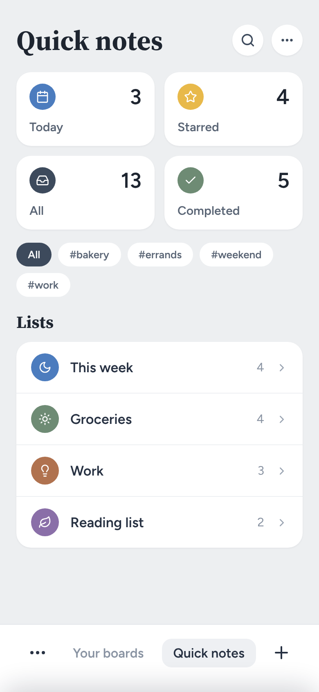
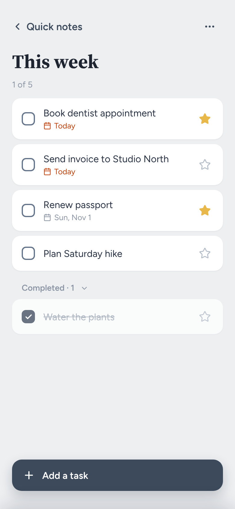
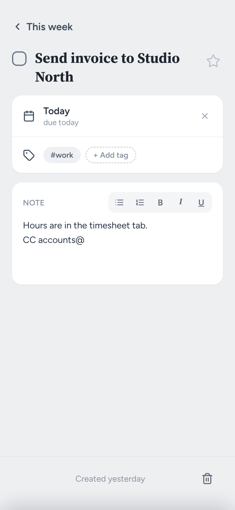
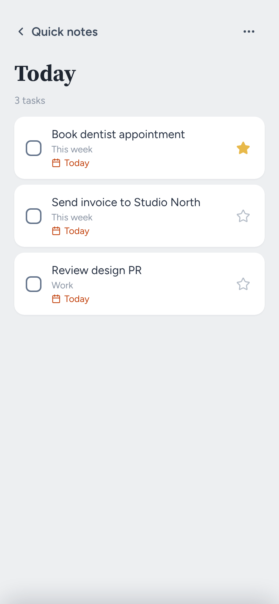
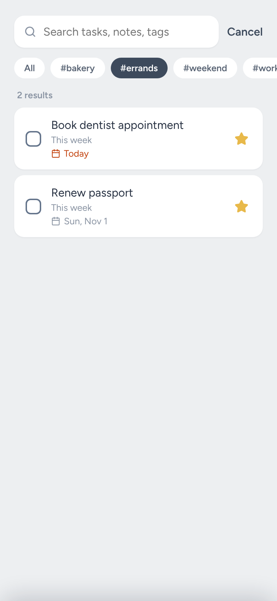
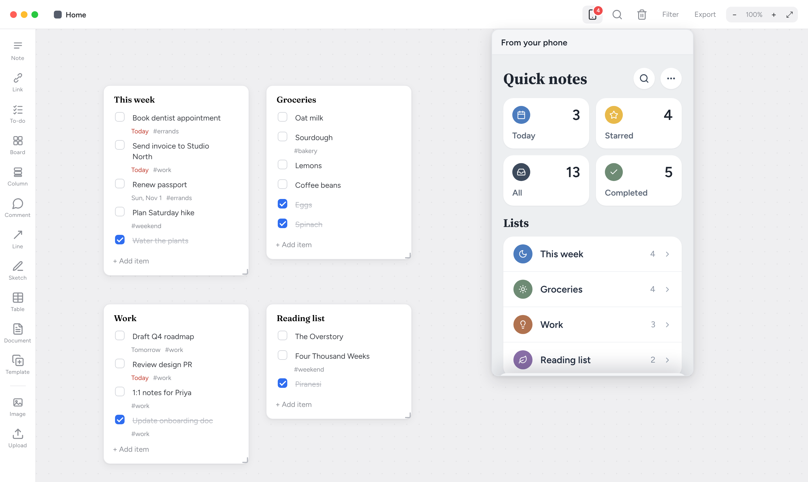

# Milaclone

A self-hosted, Milanote-style visual board for notes, tasks, links, images and
nested boards. It's a small Node.js app, and everything lives in one SQLite
file you own.


## Features

- **Infinite canvas.** Pan, zoom, drag-select, snap to grid, plus undo (⌘Z).
- **Card types:**
  - rich-text notes and full-screen documents
  - to-do lists with nesting, drag-to-reorder, due dates and tags
  - links, with YouTube, Vimeo and Spotify embeds
  - images and files
  - columns that collapse
  - nested boards with colours and icons, and shortcuts to them
  - comments, colour swatches, simple tables and freehand sketches
- **Lines and arrows** between cards, with labels and dashed styles.
- **Organising:** labels with a board filter, templates, and search across
  every board with ⌘K.
- **Trash and undo:** deleting moves a card to Trash, so it can always be
  restored.
- **Export:** a board to Markdown, or a full database backup.
- **Mobile layout,** including [Quick notes](#quick-notes-every-to-do-list-in-one-place),
  a task view of every to-do list.
- **Dark mode** that follows your system setting.

|                   Dark mode                   |                          Mobile                          |                      Quick notes                       |
| :-------------------------------------------: | :------------------------------------------------------: | :----------------------------------------------------: |
|  |  |  |

## Quick notes: every to-do list in one place

Quick notes turns all your to-do cards into a task app. Every to-do card on
every board, however deep it's nested, shows up here as a list. It's the same
data, not a copy: tick a task on your phone and it's ticked on the board.

|                              Overview                              |                     A list                      |                        A task                        |
| :----------------------------------------------------------------: | :---------------------------------------------: | :--------------------------------------------------: |
|  |  |  |

- **Smart views.** _Today_, _Starred_, _All_ and _Completed_ collect tasks
  from every list, so you can see what's due without opening boards one by
  one. Each task in a smart view names the list it came from.
- **One list at a time.** Tap a list to see only its tasks. Finished tasks fold
  into a _Completed_ group you can collapse, and **Add a task** stays at the
  bottom of the screen.
- **Task details.** Each task can have a star, a due date, tags and a note
  (with bullets, numbering, bold, italic and underline).
- **Tags and search.** Search matches task text and notes. Tap a tag chip to
  see every task with that tag, across all your lists. Turn on _Tag filters_
  in the overview's **···** menu to narrow the lists to those with a tagged
  task.
- **Back to the board.** A list's **···** menu has _Show on board_, which opens
  the board the card lives on. It also has _Rename list_ and _Delete list_.
  Delete can be undone.
- **On the board too.** Due dates and tags you set in Quick notes show up on
  the to-do card. Edits made on two devices at once are merged task by task,
  so neither one overwrites the other.

|                          Today                           |                          Search by tag                           |
| :------------------------------------------------------: | :--------------------------------------------------------------: |
|  |  |

**Opening it:** on a phone, tap **Quick notes** in the bottom bar. On a
computer, click the phone icon in the top bar. Quick notes opens as a panel
next to your board, so you can see a list and its card side by side:



To make a new list, tap **+** in Quick notes and pick _Todo list_, or add a
to-do card to any board.
The **···** menu on the overview can hide the smart views.

## Run it

You need Node.js 18 or newer.

```bash
npm install
npm start          # http://localhost:4321
```

Or with Docker:

```bash
docker compose up -d --build
```

The Compose file also runs a Tailscale sidecar that serves the app over HTTPS
on your tailnet. Put `TS_AUTHKEY=…` in `.env` first. For setup, deploys and
running without Docker, see [docs/self-hosting.md](docs/self-hosting.md).

## Put it on your phone

Milaclone works as a home-screen app. Your computer runs the server and your
phone connects to it, so the computer has to be on and reachable from the
phone.

**On the same Wi-Fi as the computer running `npm start`:**

1. Find the computer's local IP address:
   - macOS: `ipconfig getifaddr en0`
   - Linux: `hostname -I`
   - Windows: `ipconfig` (the "IPv4 Address" line)
2. On your phone, open `http://<that-address>:4321`, for example
   `http://192.168.1.20:4321`. If the page doesn't load, allow incoming
   connections for Node in the computer's firewall. macOS asks you about this
   the first time.
3. Add it to the home screen:
   - **iPhone/iPad (Safari):** tap Share → **Add to Home Screen**. It opens
     fullscreen with its own icon, like any other app.
   - **Android (Chrome):** tap ⋮ → **Add to Home screen**. Over plain
     `http://` Chrome adds a shortcut that opens in the browser. For a full
     app install, serve it over HTTPS (see below).
4. Open it and tap **Quick notes** in the bottom bar.

**From anywhere, over HTTPS:** put the app on your
[Tailscale](https://tailscale.com) tailnet. The Docker setup does this for you,
or run `sudo tailscale serve --bg 4321` next to `npm start`. Then open
`https://<machine>.<your-tailnet>.ts.net` on the phone and add it to the home
screen as above. Over HTTPS the app also keeps a copy of what it last loaded,
so it still opens if the connection drops. You need a connection to make
edits. The
details are in [docs/self-hosting.md](docs/self-hosting.md#access-over-tailscale).

> [!NOTE]
> Milaclone has no login. Anyone who can reach the address can read and edit
> your boards, so only open it up on networks you trust. The Docker setup
> listens on `127.0.0.1` only, so the Wi-Fi steps above apply to `npm start`.
> With Docker, use Tailscale instead.

## Your data

| What    | Where                                                       |
| ------- | ----------------------------------------------------------- |
| Boards  | `data/board.db` (SQLite, or the `milaclone_data` volume)    |
| Uploads | `public/uploads/` (or the `milaclone_uploads` volume)       |
| Backup  | **Export → Download database backup**, or `GET /api/backup` |

You can set three environment variables: `PORT` (default 4321), `HOST`
(default `0.0.0.0`) and `DATA_DIR` (default `./data`).

## Import from Milanote

`scripts/import-milanote.js` reads Milanote's Markdown export and recreates
its boards, notes, to-dos, links and images in a running instance, under a
staging board on Home:

```bash
node scripts/import-milanote.js --base http://localhost:4321 --into "From Milanote" --dry-run my-board.md
```

`--dry-run` prints the plan and counts and writes nothing; drop it to import.
Every card remembers its Milanote id, so re-running skips what's already there,
and anything that couldn't be imported is listed at the end.

## Development

```bash
npm test             # API tests (80% coverage floor)
npm run test:ui      # front-end unit tests (Vitest)
npm run test:e2e     # Playwright (run `npx playwright install` once first)
npm run lint && npm run format
```

The backend is Express with `better-sqlite3`. The frontend is vanilla ES modules
with no framework, and the only build step is the rich-text editor, which the
server bundles at boot. [CLAUDE.md](CLAUDE.md) explains the architecture.

## License

[MIT](LICENSE)

Milaclone is an independent project. It isn't affiliated with or endorsed by
Milanote. Milanote is a trademark of its owner and is named here only to
describe the importer.
