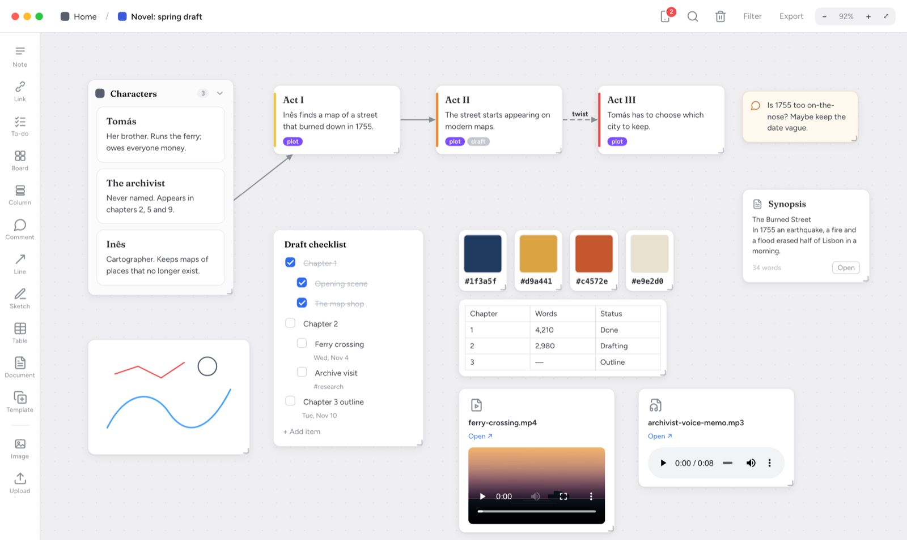
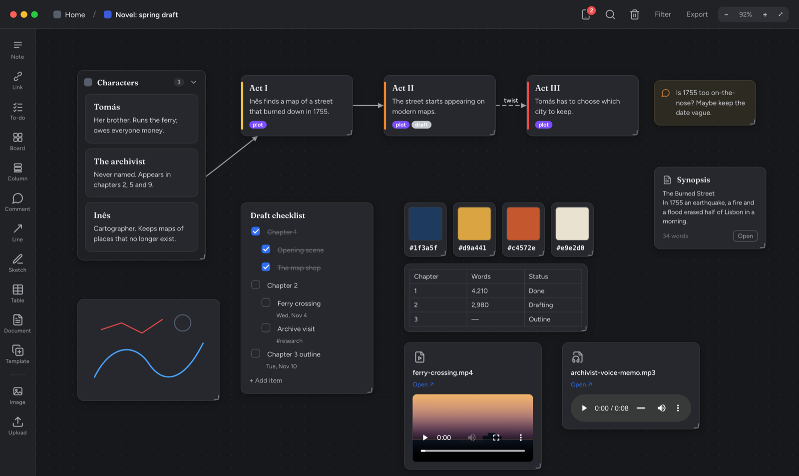
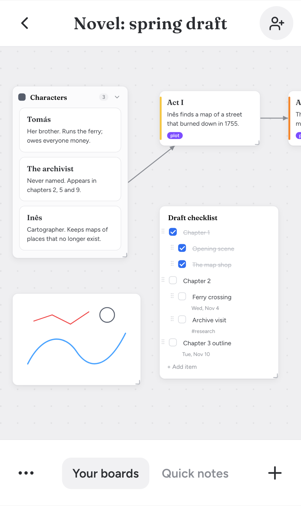
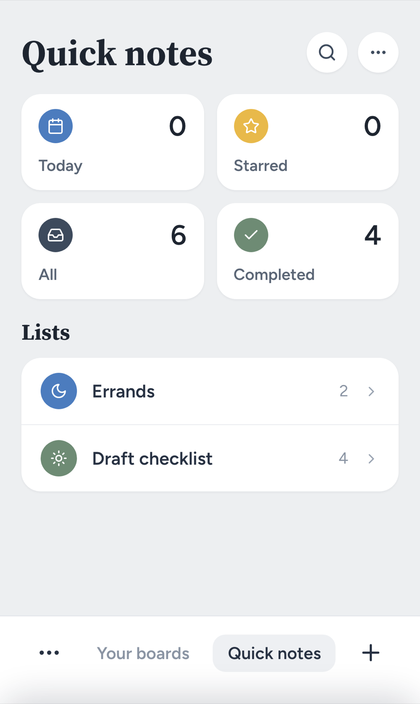

# Milaclone

A self-hosted, Milanote-style visual board for notes, tasks, links, images and
nested boards. It's a small Node.js app, and everything lives in one SQLite
file you own.



## Features

- **Infinite canvas.** Pan, zoom, drag-select, snap to grid, plus undo (⌘Z).
- **Card types:**
  - rich-text notes and full-screen documents
  - to-do lists with nesting, drag-to-reorder, due dates and tags
  - links, with YouTube, Vimeo and Spotify embeds
  - images and files
  - columns that collapse
  - nested boards with colours and icons, and shortcuts to them
  - comments, colour swatches, simple tables and freehand sketches
- **Lines and arrows** between cards, with labels and dashed styles.
- **Organising:** labels with a board filter, templates, and search across
  every board with ⌘K.
- **Trash and undo:** deleting moves a card to Trash, so it can always be
  restored.
- **Export:** a board to Markdown, or a full database backup.
- **Mobile layout,** including a Quick notes view for every to-do list.
- **Dark mode** that follows your system setting.

|                   Dark mode                   |                          Mobile                          |                      Quick notes                       |
| :-------------------------------------------: | :------------------------------------------------------: | :----------------------------------------------------: |
|  |  |  |

## Run it

You need Node.js 18 or newer.

```bash
npm install
npm start          # http://localhost:4321
```

Or with Docker:

```bash
docker compose up -d --build
```

The Compose file also runs a Tailscale sidecar that serves the app over HTTPS
on your tailnet. Put `TS_AUTHKEY=…` in `.env` first. For setup, deploys and
running without Docker, see [docs/self-hosting.md](docs/self-hosting.md).

## Your data

| What    | Where                                                       |
| ------- | ----------------------------------------------------------- |
| Boards  | `data/board.db` (SQLite, or the `milaclone_data` volume)    |
| Uploads | `public/uploads/` (or the `milaclone_uploads` volume)       |
| Backup  | **Export → Download database backup**, or `GET /api/backup` |

You can set three environment variables: `PORT` (default 4321), `HOST`
(default `0.0.0.0`) and `DATA_DIR` (default `./data`).

## Import from Milanote

`scripts/import-milanote-md.js` reads Milanote's Markdown export and recreates
its boards, notes, to-dos and links in a running instance:

```bash
node scripts/import-milanote-md.js --base http://localhost:4321 my-board.md
```

## Development

```bash
npm test             # API tests (80% coverage floor)
npm run test:ui      # front-end unit tests (Vitest)
npm run test:e2e     # Playwright (run `npx playwright install` once first)
npm run lint && npm run format
```

The backend is Express with `better-sqlite3`. The frontend is vanilla ES modules
with no framework, and the only build step is the rich-text editor, which the
server bundles at boot. [CLAUDE.md](CLAUDE.md) explains the architecture.

## License

[MIT](LICENSE)
